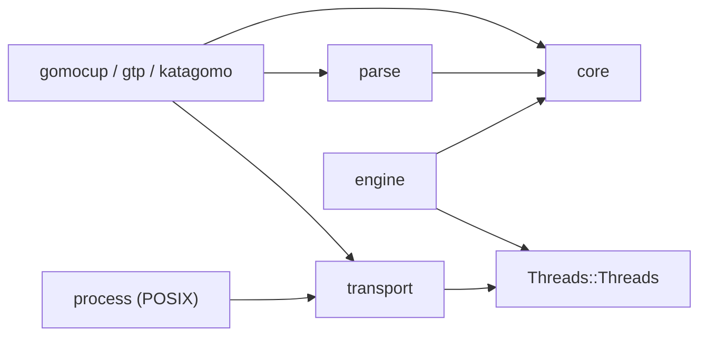
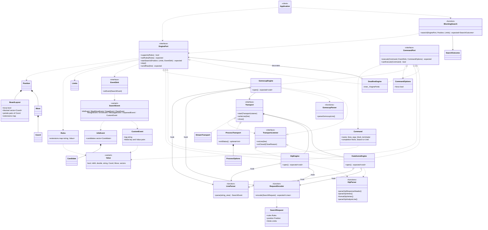
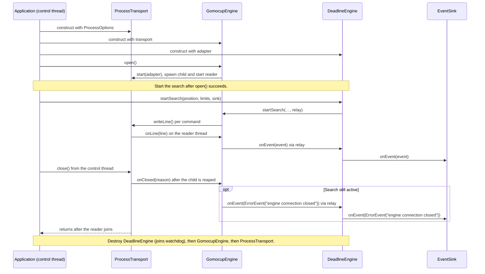

# libgomo architecture

## Intent

libgomo connects applications to Gomoku engines through a protocol-neutral `EnginePort`.
The application selects the concrete adapter and transport when it opens a session.

[Draw.io source](architecture.drawio) · [PNG with embedded Draw.io source](architecture.drawio.png)

## Structure

Arrows show direct CMake link dependencies. The parser links `gomo::core` for the
protocol-neutral values and events it returns. [CMakeLists.txt](../../CMakeLists.txt)

## Interfaces

`InfoEvent` holds search-wide summary fields (`depth`, `nodes`, `elapsed`, plus `score` and
`principalVariation` from an unranked line or the rank-1 candidate) and a `candidates` list of
`Candidate` values for per-move analysis.
[search_event.hpp](../../include/gomo/core/search_event.hpp)

### Extension points

Four additions let an application support an engine's own commands, rules and board structure
without editing the library. Each is opt-in: set none and the adapters behave as before. The
decision and the rejected options are in
[ADR-02](../adr/ADR-02-extensible-engine-commands.md).

- `CommandPort` is a second interface beside `EnginePort`, which is unchanged. `Command` is data
  with a completion: `None` (done once written), `Search` (ends at a terminal event) or
  `Until` (ends at the first event the predicate accepts). `CommandOptions::force` stops the
  running work and writes the command after its terminal event, because Rapfi drops commands sent
  while it thinks. `DeadlineEngine` forwards to the wrapped engine; `GtpEngine` supports `None`
  only. [command_port.hpp](../../include/gomo/core/command_port.hpp)
- `RequestEncoder` replaces the whole script of one `startSearch`. It is a constructor argument
  of each adapter, with the default builders public in `gomo::encode` so an application edits
  the default script instead of rewriting it. It runs under the adapter lock and must be pure.
  [search_request.hpp](../../include/gomo/core/search_request.hpp) ·
  [gomocup_encode.hpp](../../include/gomo/gomocup/gomocup_encode.hpp)
- `LineParser` replaces or extends how an adapter reads a line; `chainParsers` asks the
  application's parser first and falls back to the built-in one. A parser can yield
  `CustomEvent`, which is not terminal (`isTerminal`). The core keeps one terminal test for
  every adapter and decorator. [line_parser.hpp](../../include/gomo/parse/line_parser.hpp)
- `BoardLayout` (torus, blocked cells, portals) belongs to `Position`; `Rules::extensions` holds
  rules the enums lack. Both are plain data: the core checks only that cells are on the board, and
  the engine decides what it can play. The default encoders refuse them with `Unsupported`
  rather than drop them. [board_layout.hpp](../../include/gomo/core/board_layout.hpp) ·
  [rules.hpp](../../include/gomo/core/rules.hpp)

`Value` is the typed argument and field type used by all four
([value.hpp](../../include/gomo/core/value.hpp)). The core still includes no I/O, thread or
protocol header, so the dependency diagram above does not change; the adapters gain the
`encode` builders in their own module.

## Session lifecycle

The example uses `GomocupEngine` and `ProcessTransport` on POSIX. The application owns the
transport, adapter, decorator and sink. The adapter borrows the transport, the transport
borrows the adapter as its listener, and the decorator borrows the adapter and the active
search sink. During a search, the adapter calls the relay owned by `DeadlineEngine`.

## Trade-offs

The application coordinates shutdown because it owns the session objects. It calls
`close()` from the control thread while the adapter, decorator and any active sink are
still alive. `GomocupEngine::onClosed()` only emits `ErrorEvent{"engine connection closed"}`
while a search is active. If the watchdog has already timed out that search, the relay
consumes the terminal event. [GomocupEngine source](../../src/gomocup/gomocup_engine.cpp#L136-L152) ·
[DeadlineEngine source](../../src/engine/deadline_engine.cpp#L78-L107)

The sink can be released once its terminal callback returns, including a timeout callback
from the watchdog. [ProcessTransport](../../include/gomo/process/process_transport.hpp) ·
[GomocupEngine](../../include/gomo/gomocup/gomocup_engine.hpp) ·
[DeadlineEngine](../../include/gomo/engine/deadline_engine.hpp)
