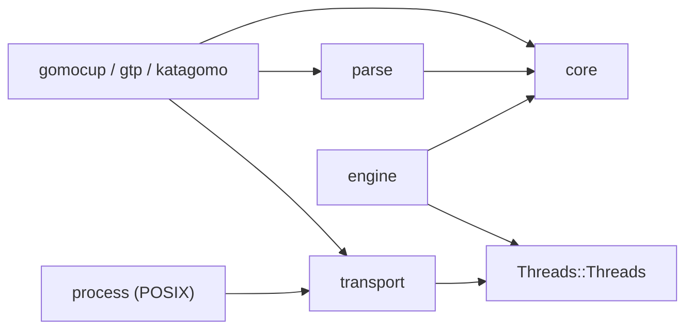
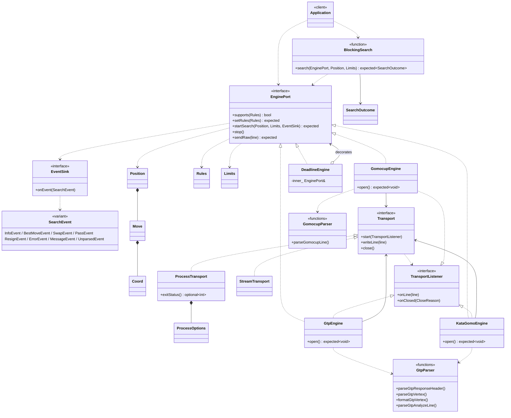
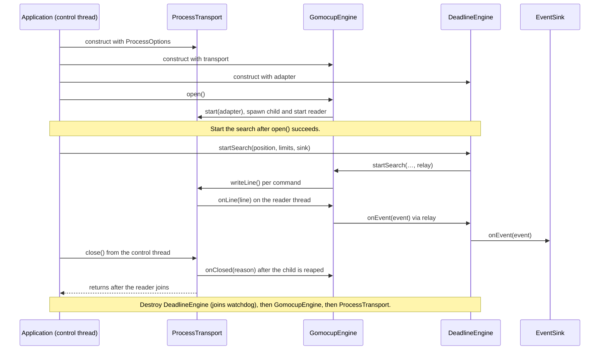

# PyGomo architecture

## Intent

PyGomo connects applications to Gomoku engines through a protocol-neutral `EnginePort`.
The application selects the concrete adapter and transport when it opens a session.

[Draw.io source](architecture.drawio) · [PNG with embedded Draw.io source](architecture.drawio.png)

## Structure

Arrows show direct CMake link dependencies. The parser links `pygomo::core` for the
protocol-neutral values and events it returns. [CMakeLists.txt](../../CMakeLists.txt)

## Interfaces

## Session lifecycle

The example uses `GomocupEngine` and `ProcessTransport` on POSIX. The application owns the
transport, adapter, decorator and sink. The adapter borrows the transport, the transport
borrows the adapter as its listener, and the decorator borrows the adapter and the active
search sink. During a search, the adapter calls the relay owned by `DeadlineEngine`.

## Trade-offs

The application coordinates shutdown because it owns the session objects. It calls
`close()` from the control thread while the adapter, decorator and any active sink are
still alive. A close can deliver a final `ErrorEvent` for an active search. The sink can
be released once its terminal callback returns, including a timeout callback from the
watchdog. [ProcessTransport](../../include/pygomo/process/process_transport.hpp) ·
[GomocupEngine](../../include/pygomo/gomocup/gomocup_engine.hpp) ·
[DeadlineEngine](../../include/pygomo/engine/deadline_engine.hpp)
